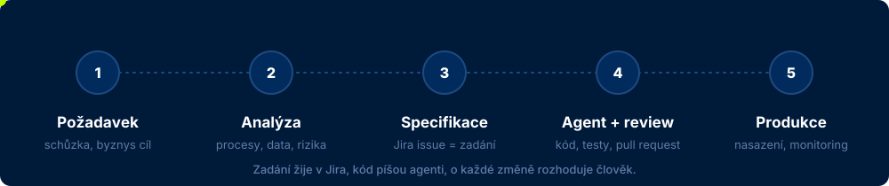

&nbsp;

**Z nejasného zadání dělám systémy, které lidé opravdu používají.**

**Teď** &nbsp;·&nbsp; business analýza a řízení projektů v bankovním IT 
**Moje firma** &nbsp;·&nbsp; [SEBIT Solutions](https://sebit.cz) – IT consulting, vývoj na míru, data a AI 
**Ozvěte se** &nbsp;·&nbsp; [info@sebit.cz](mailto:info@sebit.cz)

&nbsp;

### Co dělám

 

### Jak pracuji

  

  

